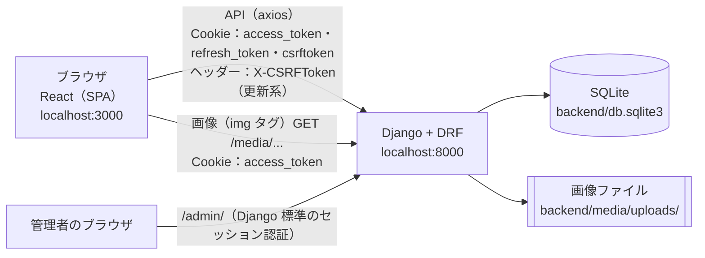
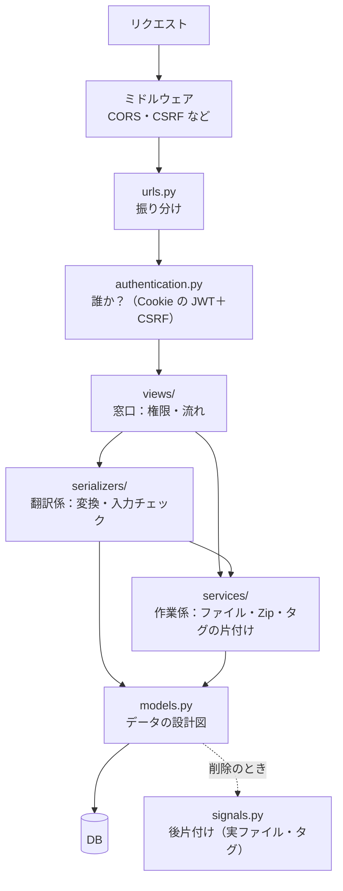

# アーキテクチャ

- 最終更新：2026-11-19（改修案件08 まで反映）
- 対象：開発環境の構成（本番環境は想定しない。[調査報告書 Q-003](../04_改修事案/00_調査報告書.md)）
- 関連：[機能一覧](02_機能一覧.md)・[画面一覧](03_画面一覧.md)・[シーケンス図](04_シーケンス図.md)・[API 定義](api/index.yaml)・[DB 設計](db/tables.md)

## 1. 全体像

| 要素 | 役割 | 根拠 |
|---|---|---|
| Frontend | 画面。React の SPA（1 枚の HTML の中で画面を切り替える） | `frontend/src/App.tsx` |
| Backend | API と画像の配信、管理画面 | `backend/chocolatier_core/urls.py` |
| DB | 利用者・スナップ・画像の情報・タグ | `settings.py` の `DATABASES` |
| 画像ファイル | アップロードされた画像の実体。DB には場所（パス）だけを持つ | `settings.py` の `MEDIA_ROOT` |

## 2. 技術スタック

| 区分 | 名前 | バージョン |
|---|---|---|
| 実行環境 | Python / Node.js | 3.13 / 24 |
| Backend | Django / djangorestframework | 5.2.5 / 3.16.1 |
| Backend | djangorestframework_simplejwt（JWT） | 5.5.1 |
| Backend | django-cors-headers / Pillow（画像の中身チェック） | 4.7.0 / 12.3.0 |
| DB | SQLite | Python 同梱 |
| Frontend | React / react-router-dom / axios | 18.3.1 / 7.x / 1.x |
| Frontend | react-easy-crop（トリミングの範囲選択） | 6.2.5 |
| Frontend | TypeScript / react-scripts（Create React App） | 4.9.5 / 5.0.1 |

## 3. Backend の構成

### 3-1. 層と役割
リクエストは上から下へ流れる。View（窓口）は流れだけを決め、変換・チェックは Serializer、実際の作業は Service に任せる。

| 層 | ファイル | 主な中身 |
|---|---|---|
| 設定 | `chocolatier_core/settings.py` | 認証の方式、Cookie、上限値、CORS |
| URL | `chocolatier_core/urls.py`、`chocolatier_api/urls.py` | 認証 API・画像は前者、Snap・タグ・ユーザーは後者 |
| 認証 | `chocolatier_api/authentication.py` | `CookieJWTAuthentication`（Cookie の access_token を検証し、CSRF も確かめる） |
| 窓口 | `views/snap.py`・`tag.py`・`user.py`・`auth.py`・`media.py` | API ごとのクラス |
| 翻訳係 | `serializers/snap.py`・`user.py` | 入力チェックとレスポンスの形 |
| 作業係 | `services/files.py`・`zip.py`・`tags.py` | 画像の保存・削除、Zip の作成、使われていないタグの削除 |
| 後片付け | `signals.py`（`apps.py` の `ready()` で登録） | スナップ・画像が消えたときの実ファイルとタグの削除 |
| データ | `models.py`、`migrations/` | User・File・Snap・Tag |
| 区切り方 | `pagination.py` | 一覧を 12 件ずつ（cursor 方式） |
| 管理画面 | `admin.py` | 利用者・ファイル・スナップ・タグの管理 |

### 3-2. 共通の決まり
| 項目 | 決まり | 根拠 |
|---|---|---|
| 認証 | 特に指定のない API はログイン必須（未ログインは 401） | `settings.py` の `REST_FRAMEWORK` |
| 認証情報の置き場所 | HttpOnly Cookie（JS から読めない）。access 60 分・refresh 1 日 | `views/auth.py` の `set_auth_cookies` |
| CSRF | Cookie で認証した更新系（POST・PATCH・DELETE）は、`csrftoken` Cookie と `X-CSRFToken` ヘッダーの一致が必要（不一致は 403） | `authentication.py` の `enforce_csrf` |
| 持ち主 | スナップと画像は持ち主だけが扱える。他人の ID は 404（存在を知らせない） | `views/snap.py`・`views/media.py` |
| エラーの形 | 入力チェックは `{項目名: [メッセージ]}`、それ以外は `{detail: メッセージ}`。日本語（DRF に訳がないものは英語） | DRF・`LANGUAGE_CODE = 'ja'` |
| 上限値 | `settings.py` にまとめ、Frontend の `validators.ts` にも同じ値を書く。ずれたらテストが失敗する | `tests/test_fixes.py` の `LimitsSyncTests` |
| 使わない HTTP メソッド | 開けておかない（Snap の PUT は 405） | `SnapDetail.http_method_names` |

## 4. Frontend の構成

| フォルダ | 役割 | 主なファイル |
|---|---|---|
| `pages/` | 画面 | `WelcomePage`・`SignInPage`・`SnapshotPage`・`PlayGroundPage` |
| `components/commons/` | 共通部品 | `BasicButton`・`Modal`・`FileInput`・`ImageCropper`・`TagInput`・`Message`・`ProtectedRoute`・`GuestRoute` など |
| `components/snap/` | スナップ専用の部品 | `SnapshotPanel`（一覧の 1 枚） |
| `components/playground/` | 部品の見本（playground 画面用） | `*Template.tsx` |
| `contexts/` | アプリ全体で共有する状態 | `AuthContext`（ログイン中の利用者） |
| `api/` | API の呼び出し口 | `client.ts`（Cookie 送信・CSRF ヘッダー・401 のときの自動 refresh） |
| `hooks/` | 使い回す処理 | `useInfiniteScroll` |
| `utils/` | 画面に依存しない処理 | `validators.ts`（上限値・チェック）・`apiError.ts`（エラー表示）・`cropImage.ts`（切り抜き） |
| `types/` | 型 | `Snap`・`AuthContextType` |

| 項目 | 決まり | 根拠 |
|---|---|---|
| API の呼び方 | 必ず `api/client.ts` の `client` を使う（`withCredentials`・`X-CSRFToken` を自動で付ける） | `client.ts` |
| ログイン状態 | 起動時に `/csrf/` と `/user-info/` を呼んで決める。問い合わせが終わるまで画面を出さない | `AuthContext.tsx` |
| 401 のとき | `/token/refresh/` を 1 回だけ呼んで、元のリクエストを 1 回だけ再送。失敗したらログアウト状態 | `client.ts` |
| 画面の保護 | ログインが必要な画面は `ProtectedRoute`、ログインしていない人の画面は `GuestRoute` で囲む | `App.tsx` |
| 画像の一時 URL | `createObjectURL` は、作るのも破棄するのも同じ `useEffect` の中で行う（StrictMode 対策） | `SnapshotPage`・`ImageCropper` |

## 5. データの保存

| 対象 | 保存先 | 決まり |
|---|---|---|
| 利用者・スナップ・タグ | SQLite | [DB 設計](db/tables.md) |
| 画像 | `backend/media/uploads/<元の名前>_<yyyymmddHHMMSS><拡張子>` | DB の `file.path` に `uploads/...` を持つ。スナップと 1 対 1 |
| 画像の配信 | `GET /media/<path>` | ログインした持ち主だけ（`views/media.py`）。他人・存在しないものは 404 |

## 6. 動かし方（開発環境）

| 項目 | 内容 |
|---|---|
| 起動 | `start_chocolatier.bat`（Backend の `runserver`・Frontend の `npm start`・Edge の専用ウィンドウ）。手順はリポジトリ直下の `README.md` |
| 終了 | `stop_chocolatier.bat`（3000・8000 番を使うプログラムも止める） |
| テスト | Backend：`python manage.py test chocolatier_api`／Frontend：`npm test`（→ [開発ガイド](../03_開発/00_開発ガイド.md)） |
| 本番 | 想定しない（`DEBUG = True`・`SECRET_KEY` はコードに直書き・`ALLOWED_HOSTS = []`） |
| 外部連携・バッチ | なし |
