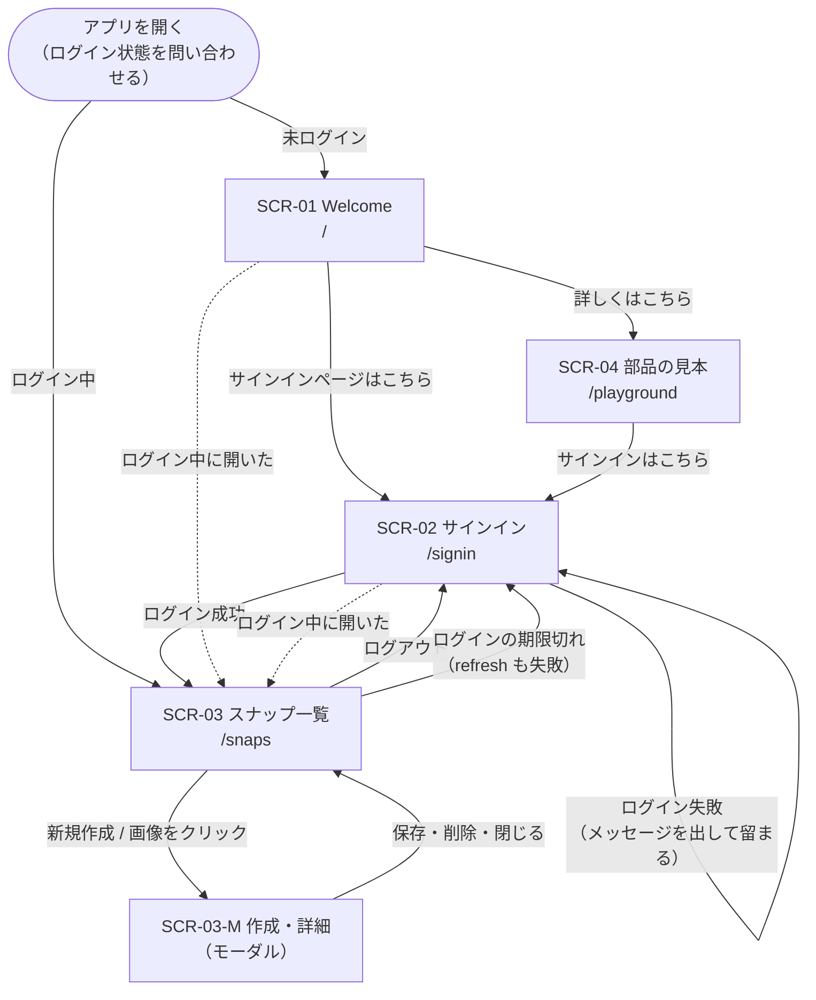
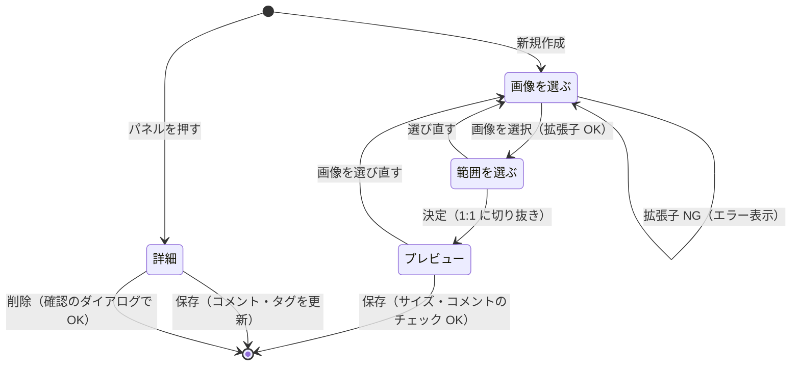

# 画面一覧と画面遷移

- 最終更新：2026-11-19（改修案件08 まで反映）
- 関連：[機能一覧](02_機能一覧.md)・[シーケンス図](04_シーケンス図.md)
- 根拠：`frontend/src/App.tsx`（URL と画面の対応）、各画面の `pages/*.tsx`

## 1. 画面一覧

| ID | 画面 | URL | 見られる人 | 主な機能 | ファイル |
|---|---|---|---|---|---|
| SCR-01 | Welcome（アプリの紹介） | `/` | ログインしていない人（ログイン中は `/snaps` へ移動） | サインイン画面・部品の見本への入口 | `pages/WelcomePage/WelcomePage.tsx` |
| SCR-02 | サインイン | `/signin` | ログインしていない人（ログイン中は `/snaps` へ移動） | FN-001 | `pages/SignInPage/SignInPage.tsx` |
| SCR-03 | スナップ一覧 | `/snaps` | ログイン中の人（未ログインは `/signin` へ移動） | FN-010〜012・018・019 | `pages/SnapshotPage/SnapshotPage.tsx` |
| SCR-03-M | スナップ作成・詳細（モーダル） | （`/snaps` の中） | ログイン中の人 | FN-013〜017 | `SnapshotPage.tsx` の `<Modal>` |
| SCR-04 | UI 部品の見本（Chocolate Factory） | `/playground` | 誰でも | FN-040 | `pages/PlayGroundPage/PlayGroundPage.tsx` |
| SCR-05 | 管理画面（Django 標準） | `http://localhost:8000/admin/` | 管理者（`is_staff`） | FN-030 | `backend/chocolatier_api/admin.py` |
| 共通 | ヘッダー | 全画面 | ― | アプリ名 → `/`、ログイン中だけ「ログアウト」 | `components/commons/Header/Header.tsx` |

- 定義のない URL（例：`/abc`）は、ヘッダーだけの空の画面になる（[調査報告書 Q-015](../04_改修事案/00_調査報告書.md) の後半。回答待ち）

## 2. 画面遷移図

| 遷移 | 条件 | 根拠 |
|---|---|---|
| `/snaps` → `/signin` | 未ログイン、またはログインの期限切れ（refresh も失敗） | `ProtectedRoute`、`AuthContext` の `setOnUnauthorized` |
| `/`・`/signin` → `/snaps` | ログイン中（改修案件08） | `GuestRoute` |
| ヘッダーのアプリ名 | 常に `/` へ。ログイン中は、そこから `/snaps` へ | `Header.handleGoHome`、`GuestRoute` |
| ログアウト | Cookie を消してもらい、`/signin` へ | `Header.handleLogout` |
| 移動に `replace` を使う | 「戻る」で、移動前の画面に戻らない | `ProtectedRoute`・`GuestRoute` |

## 3. 画面ごとの中身

### SCR-01 Welcome
| 要素 | 動き |
|---|---|
| ロゴ・タイトル「Chocolatier」・紹介文 | 表示だけ |
| 「サインインページはこちら」 | `/signin` へ |
| 「UI コンポーネント集 Chocolate Factory」の「詳しくはこちら」 | `/playground` へ |

### SCR-02 サインイン
| 要素 | 動き |
|---|---|
| username・password | 入力欄（password は伏せ字） |
| 「Sign in」 | 未入力なら「ユーザー名とパスワードを入力してください」。失敗なら「ユーザー名またはパスワードが違います」（どちらが違うかは言わない）。成功なら `/snaps` へ |

### SCR-03 スナップ一覧
| 要素 | 動き |
|---|---|
| 「新規作成」（左上） | 作成のモーダルを開く |
| 「「タグ名」の N 枚を Zip でダウンロード」（右上） | 表示中のスナップ（最大 100 枚）を Zip で保存する。タグを選んでいないときは「すべての N 枚…」。0 件・ダウンロード中は押せない。100 枚を超えたら「表示中の N 枚のうち、新しい 100 枚まで」と横に出す |
| タグの絞り込み（チップ） | 「すべて」＋自分が使っているタグ。押すとそのタグで一覧を取り直す |
| 一覧 | 200×200 の正方形のパネルが並ぶ（正方形でない画像は中央を切って表示）。下までスクロールすると 12 件ずつ続きを読み込む。パネルを押すと詳細のモーダル |
| お知らせ | Zip の結果（100 枚を超えたお知らせは 5 秒で消える。エラーは残る） |

### SCR-03-M 作成・詳細（モーダル）

| 要素 | 作成 | 詳細 |
|---|---|---|
| 見出し | 「スナップ作成」 | 「スナップ詳細」 |
| 画像 | 選ぶ（ドロップ・選択）→ 1:1 で範囲を選ぶ → 300px のプレビュー＋「画像を選び直す」 | 登録済みの画像（300px）。変更はできない |
| コメント | 1000 文字まで。文字数を「N / 1000」で表示し、超えたら赤くする | 同じ |
| タグ | Enter で追加・× で削除（10 個・30 文字まで） | 同じ |
| 「保存」 | 「決定」の前なら「画像の範囲を「決定」してください」、未選択なら「画像を選択してください」、5MB 超えなら「画像サイズは 5MB 以下にしてください」 | コメント・タグを更新 |
| 「削除」（右上） | ― | 「本当に削除しますか？」で OK なら削除 |
| 閉じる | 「Close」・モーダルの外を押す。入力と画像はすべて消える | 同じ |
| エラー | 上にまとめて表示（API のエラーは「項目名：メッセージ」） | 同じ |

### SCR-04 UI 部品の見本
| 要素 | 動き |
|---|---|
| 部品のボタン（basicButton・container・file・message・modal・text・long text・tag input・image cropper） | 押した部品の見本を下に表示する |
| 「api」ボタン | 対応する見本がなく「Not Found」と表示される（今のまま：Q-016） |
| 「サインインはこちら」 | `/signin` へ |
