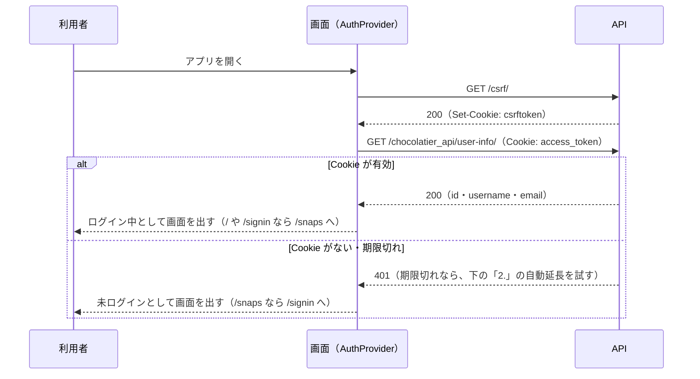
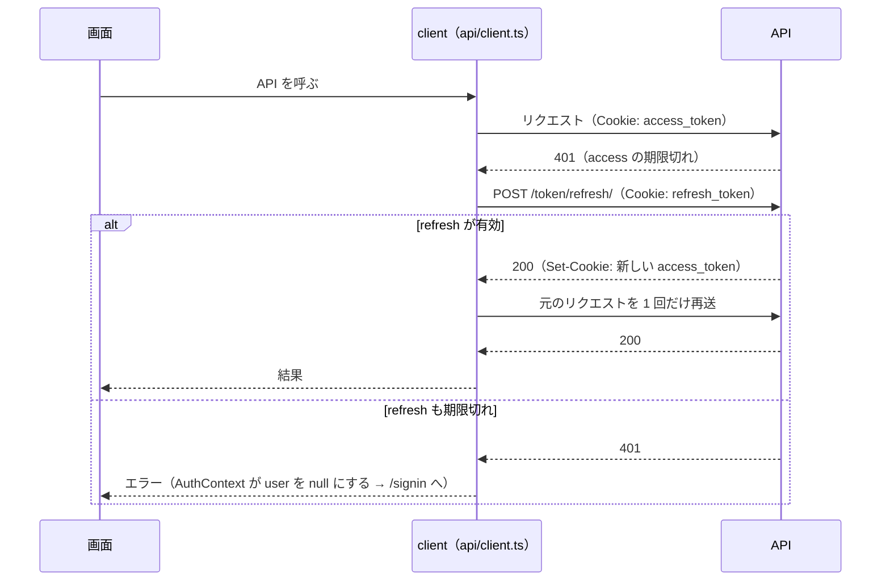
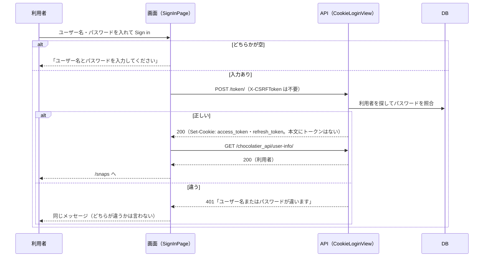
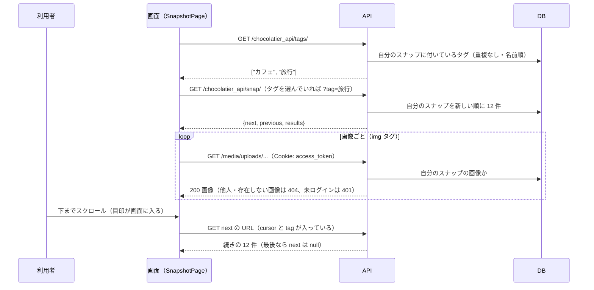
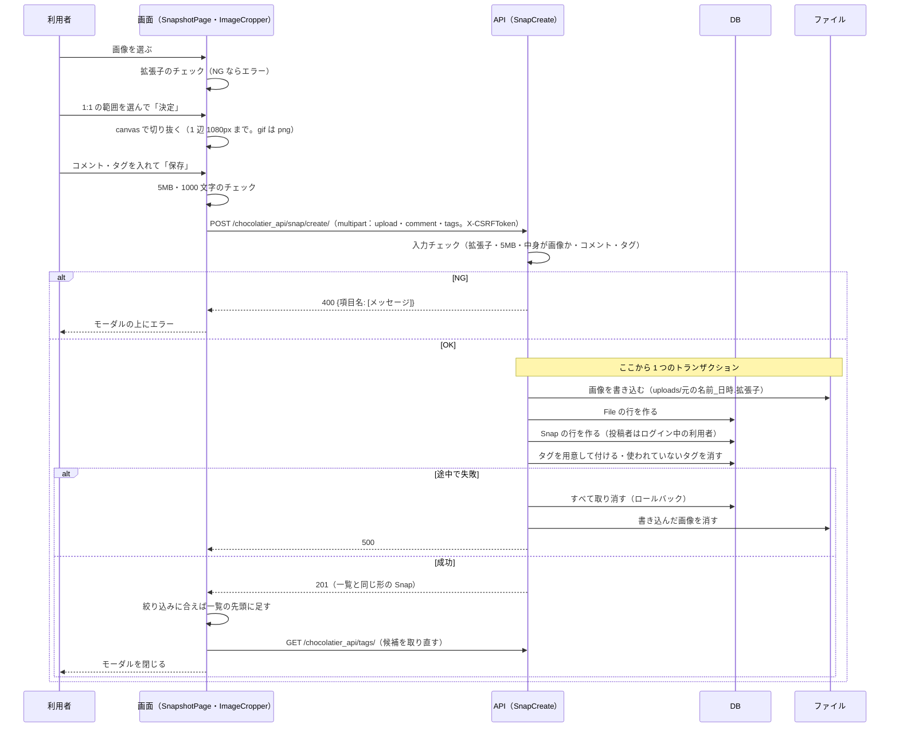
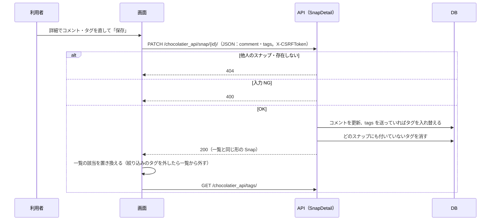
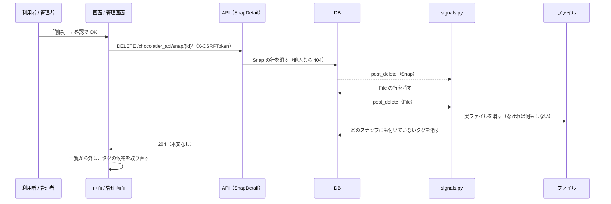
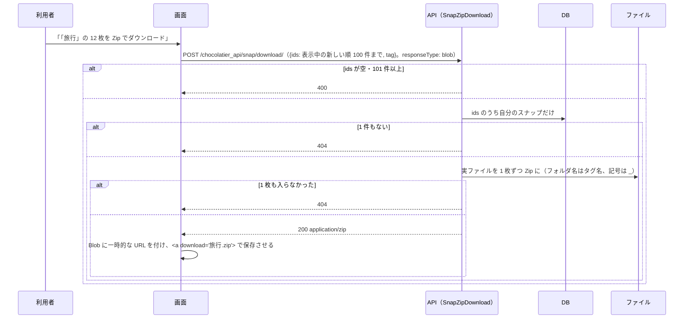
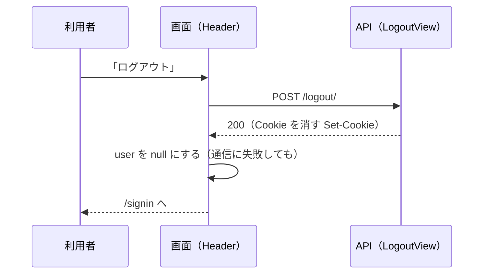

# シーケンス図

- 最終更新：2026-11-19（改修案件08 まで反映）
- 登場人物：利用者・画面（React）・`client`（`api/client.ts`）・API（Django）・DB・ファイル（`media/uploads/`）
- 関連：[機能一覧](02_機能一覧.md)・[画面一覧](03_画面一覧.md)・[API 定義](api/index.yaml)

## 1. アプリを開く（ログイン状態の復元：FN-003）

- 問い合わせが終わるまでは、画面を何も出さない（ログイン中なのに一瞬サインイン画面に飛ばされないように）。根拠：`AuthContext.tsx`

## 2. ログインの自動延長（401 のとき：FN-004）

- 同時に複数のリクエストが 401 になっても、refresh は 1 回だけ（`refreshPromise`）。再送も 1 回だけ（`_retry`）
- 認証系の URL（`/token/`・`/token/refresh/`・`/logout/`・`/csrf/`）の 401 では refresh しない（無限ループを防ぐ）

## 3. ログイン（FN-001）

## 4. 一覧を見る（無限スクロール・タグの絞り込み：FN-010〜012・019）

- タグを切り替えると、一覧と続きの URL を消して最初から取り直す。古いタグの結果があとから届いても捨てる（`requestIdRef`）

## 5. スナップを作る（FN-013・014）

## 6. スナップを更新する（FN-016）

## 7. スナップを削除する（FN-017・030）

- 管理画面でスナップや File を消したとき、利用者を消したとき（スナップが CASCADE で消える）も、`signals.py` の同じ後片付けが動く

## 8. Zip でダウンロードする（FN-018）

- エラーの本文も Blob で届くので、文字に戻してから表示する（`getApiErrorMessagesFromBlob`）

## 9. ログアウト（FN-002）

