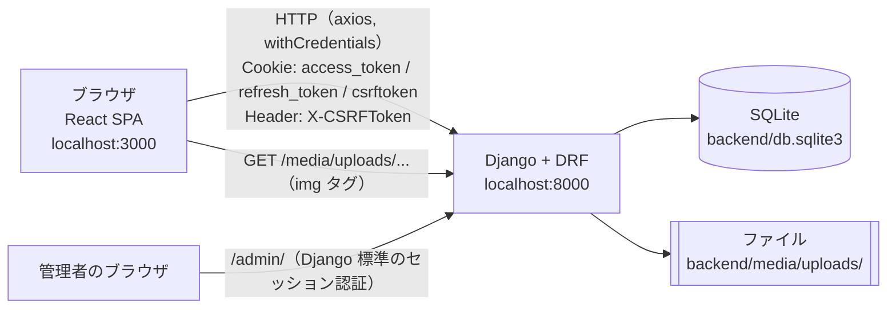

# 調査報告書（リバースエンジニアリング STEP 1〜5）

- 作成日：2026-11-18
- 状態：**レビュー待ち**（この報告書の承認後に、STEP 6〜10 の設計書の作成に進む）
- 調査の基準：**作業ツリー**（ブランチ `feat_kikuchi`、HEAD `b8a2c2e` ＋ 未コミットの変更 34 件。改修案件5・6・7 の変更を含む）
    - 改修案件7（Backend のファイルの整理）は M5（`services/` への切り出し）まで完了した状態を反映済み（2026-11-18 更新）
- この報告書を書くために、ソースコード・設定・既存ドキュメントは **一切変更していない**

> **最新の状態（2026-11-19 追記）**
>
> - 2026-11-19：Q-001〜Q-021 の回答を 4 章に記録し、「改修」のものは [改修案件08](08_調査の指摘への対応.md) で直した
> - 2026-11-19：ドキュメントの構成を `01_要件定義 / 02_設計 / 03_開発 / 04_改修事案` に作り替えた。7 章の「設計書の置き場所」の計画は、[02_設計](../02_設計/01_アーキテクチャ.md)（アーキテクチャ・機能一覧・画面一覧・シーケンス図・API・DB）に置き換わった。本文のフォルダ名は当時のまま

## 目次

- [調査報告書（リバースエンジニアリング STEP 1〜5）](#調査報告書リバースエンジニアリング-step-15)
  - [目次](#目次)
  - [0. 表記のルール](#0-表記のルール)
    - [確かさの区分](#確かさの区分)
    - [識別子](#識別子)
  - [1. STEP 1：システム全体の構成](#1-step-1システム全体の構成)
    - [1-1. 全体像【確認】](#1-1-全体像確認)
    - [1-2. 技術スタックとバージョン【確認】](#1-2-技術スタックとバージョン確認)
    - [1-3. ディレクトリ構成【確認】](#1-3-ディレクトリ構成確認)
    - [1-4. 設定値【確認】（根拠：backend/chocolatier_core/settings.py、frontend/src/api/client.ts）](#1-4-設定値確認根拠backendchocolatier_coresettingspyfrontendsrcapiclientts)
    - [1-5. 起動・運用【確認】](#1-5-起動運用確認)
  - [2. STEP 2：機能・画面・API・DB・外部連携の洗い出し](#2-step-2機能画面apidb外部連携の洗い出し)
    - [2-1. 機能一覧](#2-1-機能一覧)
    - [2-2. 画面一覧](#2-2-画面一覧)
    - [2-3. API 一覧](#2-3-api-一覧)
    - [2-4. テーブル一覧【確認：実 DB（sqlite_master）とマイグレーションで照合】](#2-4-テーブル一覧確認実-dbsqlite_masterとマイグレーションで照合)
    - [2-5. 外部連携・バッチ【確認】](#2-5-外部連携バッチ確認)
  - [3. STEP 3：業務ルールとシステムの振る舞い](#3-step-3業務ルールとシステムの振る舞い)
    - [3-1. 業務ルール（言語が変わっても守るべきこと）](#3-1-業務ルール言語が変わっても守るべきこと)
    - [3-2. 振る舞いの要点（詳細設計書で全分岐を書く）](#3-2-振る舞いの要点詳細設計書で全分岐を書く)
  - [4. STEP 4：不明点・矛盾点・仕様の欠落](#4-step-4不明点矛盾点仕様の欠落)
  - [5. 既存資料の棚卸し](#5-既存資料の棚卸し)
  - [6. 解析の範囲](#6-解析の範囲)
  - [7. 次の作業（STEP 6〜10）](#7-次の作業step-610)
    - [成果物と置き場所](#成果物と置き場所)
    - [レビューでお願いしたいこと](#レビューでお願いしたいこと)

* * *

## 0\. 表記のルール

### 確かさの区分

| 記号 | 意味 |
|---|---|
| 【確認】 | コード・設定・DB で確かめた事実。根拠のファイル・クラス・メソッドを書く |
| 【推測】 | コードやコメントから読み取った解釈。仕様としては確定しない |
| 【未確認】 | コードからは判断できない。4 章の `Q-nnn` で管理する |

### 識別子

| 種類 | 形式 | 定義している場所 |
|---|---|---|
| 要件 | `REQ-nnn` | 要件定義書（STEP 6） |
| 業務ルール | `BR-nnn` | 本書 3 章（要件定義書に引き継ぐ） |
| 機能 | `FN-nnn` | 本書 2-1 |
| 画面 | `SCR-nn` | 本書 2-2 |
| API | `API-nnn` | 本書 2-3 |
| テーブル | `TBL-nn` | 本書 2-4 |
| テストケース | `TC-xxx-nnn` | テスト仕様書（STEP 10） |
| 未確認事項 | `Q-nnn` | 本書 4 章 |

* * *

## 1\. STEP 1：システム全体の構成

### 1-1. 全体像【確認】



- 根拠：`frontend/src/api/client.ts`（`API_BASE_URL`・`withCredentials`）、`backend/chocolatier_core/settings.py`（`DATABASES`・`MEDIA_ROOT`・`CORS_ALLOWED_ORIGINS`）、`chocolatier_core/urls.py`（`admin/`・`static(MEDIA_URL)`）

### 1-2. 技術スタックとバージョン【確認】

| 区分 | 名前 | バージョン | 根拠 |
|---|---|---|---|
| 実行環境 | Python | 3.13.3 | `backend/venv` |
| 実行環境 | Node.js | 24.18.1 | 開発 PC |
| Backend | Django | 5.2.5 | `backend/requirements.txt` |
| Backend | djangorestframework | 3.16.1 | 同上 |
| Backend | djangorestframework\_simplejwt / PyJWT | 5.5.1 / 2.10.1 | 同上 |
| Backend | django-cors-headers | 4.7.0 | 同上 |
| Backend | Pillow（画像の中身チェック） | 12.3.0 | 同上 |
| DB | SQLite | （Python 同梱） | `settings.py` の `DATABASES` |
| Frontend | React / react-dom | 18.3.1 | `frontend/node_modules` |
| Frontend | react-router-dom | 7.18.5（`package.json` は `^7.1.5`） | 同上 |
| Frontend | axios | 1.21.1（`package.json` は `^1.11.0`） | 同上 |
| Frontend | react-easy-crop | 6.2.5 | 同上 |
| Frontend | TypeScript / react-scripts（Create React App） | 4.9.5 / 5.0.1 | 同上 |

### 1-3. ディレクトリ構成【確認】

```
chocolatier/
  manage.py                ← 中身は backend/manage.py と同じ形（Q-001）
  start_chocolatier.bat / stop_chocolatier.bat / create_shortcut.bat / chocolatier.ico  ← 開発 PC での起動・終了
  README.md                ← セットアップと起動の手順（UTF-16 LE で保存されている）
  .vscode/settings.json    ← venv・TypeScript の版・bat の文字コード
  backend/
    manage.py / requirements.txt / db.sqlite3（git 管理外） / media/（git 管理外）
    chocolatier_core/      ← プロジェクト（settings.py・urls.py・wsgi.py・asgi.py）
    chocolatier_api/       ← アプリ
      models.py / admin.py / authentication.py / pagination.py / urls.py
      migrations/0001_initial.py, 0002_tag_snap_tags.py
      views/      __init__.py, snap.py, tag.py, user.py, auth.py
      serializers/__init__.py, snap.py, user.py
      services/   __init__.py, files.py, zip.py（作業係：ファイルの保存・削除、Zip の作成）
      tests/      __init__.py, base.py, test_auth.py, test_snap.py, test_zip.py, test_services.py
  frontend/
    package.json / tsconfig.json / public/
    src/
      index.tsx / App.tsx / api/client.ts / contexts/AuthContext.tsx / hooks/useInfiniteScroll.ts
      pages/      WelcomePage, SignInPage, SnapshotPage, PlayGroundPage
      components/ commons/（共通部品 13 個）, snap/SnapshotPanel, playground/（部品の見本 9 個）
      utils/      apiError.ts, validators.ts, cropImage.ts, validators.test.ts
      types/      Snap.ts, AuthContextType.ts
  docs/                    ← 5 章を参照
```

### 1-4. 設定値【確認】（根拠：`backend/chocolatier_core/settings.py`、`frontend/src/api/client.ts`）

| 区分 | 設定 | 値 | 業務上の意味 |
|---|---|---|---|
| 環境 | `DEBUG` | `True` | 開発用。本番の設定は定義されていない（Q-003） |
| 環境 | `SECRET_KEY` | コードに直書き | 同上 |
| 環境 | `ALLOWED_HOSTS` | `[]` | 同上 |
| 言語・時刻 | `LANGUAGE_CODE` / `TIME_ZONE` / `USE_TZ` | `ja` / `UTC` / `True` | エラーメッセージは日本語。日時は UTC で保存 |
| 通信 | `CORS_ALLOWED_ORIGINS` / `CSRF_TRUSTED_ORIGINS` | `http://localhost:3000` のみ | 画面（React 開発サーバー）からだけ API を呼べる |
| 通信 | `CORS_ALLOW_CREDENTIALS` | `True` | Cookie を送受信する |
| 認証 | 既定の認証 / 権限 | `CookieJWTAuthentication` / `IsAuthenticated` | 特に指定のない API はログイン必須 |
| 認証 | Cookie 名 | `access_token` / `refresh_token` |  |
| 認証 | Cookie の `Secure` / `SameSite` | `not DEBUG`（今は `False`）/ `Lax` |  |
| 認証 | トークンの有効期限 | access 60 分 / refresh 1 日 |  |
| ファイル | `MEDIA_ROOT` / `MEDIA_URL` | `backend/media` / `/media/` | 画像の保存先と公開 URL |
| 上限 | `MAX_UPLOAD_SIZE` | 5MB（5×1024×1024 バイト） |  |
| 上限 | `ALLOWED_IMAGE_EXTENSIONS` | jpg / jpeg / png / gif / webp |  |
| 上限 | `MAX_COMMENT_LENGTH` / `MAX_TAGS_PER_SNAP` / `MAX_TAG_LENGTH` | 1000 / 10 / 30 |  |
| 上限 | `MAX_ZIP_DOWNLOAD` | 100 |  |
| 画面 | 一覧の 1 回の件数 | 12（`pagination.py` の `page_size`） |  |
| 画面 | `REACT_APP_API_BASE_URL`（環境変数） | 未設定なら `http://localhost:8000` | 唯一の環境変数 |
| 画面 | Frontend の上限値 | `validators.ts`・`cropImage.ts` に Backend と同じ値を **重複して** 定義 | 変えるときは両方を直す必要がある |

### 1-5. 起動・運用【確認】

- 起動は開発サーバー（`python manage.py runserver` と `npm start`）。`start_chocolatier.bat` がこの 2 つと Edge の専用ウィンドウを起動し、`stop_chocolatier.bat` がまとめて止める。
- 本番用のサーバー・ビルド配信・HTTPS・バックアップの定義は **見つからない**（Q-003）。
- ログの設定（`LOGGING`）はなく、Django の既定のまま。アプリ独自のログ出力もない（改修案件7 で `print` を削除済み）。

* * *

## 2\. STEP 2：機能・画面・API・DB・外部連携の洗い出し

### 2-1. 機能一覧

| ID | 機能 | 利用者 | 画面 / API | 根拠 |
|---|---|---|---|---|
| FN-001 | ログイン | 利用者 | SCR-02 / API-001, API-002, API-005 | `AuthContext.login`、`CookieLoginView` |
| FN-002 | ログアウト | 利用者 | ヘッダー / API-004 | `Header.handleLogout`、`LogoutView` |
| FN-003 | ログイン状態の復元（画面を開いたとき） | 利用者 | 全画面 / API-001, API-005 | `AuthProvider` の `useEffect` |
| FN-004 | ログインの自動延長（access の取り直し） | 利用者 | 全画面 / API-003 | `client.ts` のレスポンスインターセプタ、`CookieRefreshView` |
| FN-005 | ログインが必要な画面の保護 | 利用者 | SCR-03 | `ProtectedRoute` |
| FN-006 | 利用者の登録 | 管理者 | 画面なし（Postman など）/ API-006 | `UserSignup` |
| FN-010 | スナップ一覧（12 件ずつの無限スクロール） | 利用者 | SCR-03 / API-007 | `SnapshotPage.fetchPage`、`SnapList` |
| FN-011 | タグでの絞り込み | 利用者 | SCR-03 / API-007（`?tag=`） | `SnapshotPage` の `selectedTag`、`SnapList.get_queryset` |
| FN-012 | 絞り込み候補（自分のタグ）の取得 | 利用者 | SCR-03 / API-013 | `fetchTags`、`TagList` |
| FN-013 | スナップの作成（画像を選ぶ → 1:1 に切り抜く → コメント・タグ → 保存） | 利用者 | SCR-03 モーダル / API-008 | `handleCreateSubmit`、`SnapCreate` |
| FN-014 | 画像の 1:1 トリミング | 利用者 | SCR-03 モーダル（API なし） | `ImageCropper`、`cropImage.ts` |
| FN-015 | スナップの詳細表示 | 利用者 | SCR-03 モーダル | `openModal`（一覧のデータを使う。API-010 は画面からは呼ばれていない【確認】） |
| FN-016 | スナップの更新（コメント・タグ） | 利用者 | SCR-03 モーダル / API-011 | `handleUpdateSubmit`、`SnapDetail` |
| FN-017 | スナップの削除（画像ファイルも削除） | 利用者 | SCR-03 モーダル / API-012 | `handleDeleteSubmit`、`SnapDetail.destroy` |
| FN-018 | 表示中の画像の Zip ダウンロード | 利用者 | SCR-03 / API-009 | `handleDownload`、`SnapZipDownload` |
| FN-030 | データの管理（利用者・スナップ・ファイル・タグ） | 管理者 | SCR-05 | `admin.py` |
| FN-040 | UI 部品の見本（Chocolate Factory） | 開発者【推測】 | SCR-04 | `PlayGroundPage` |

### 2-2. 画面一覧

| ID | 画面 | URL | ログイン | 根拠 |
|---|---|---|---|---|
| SCR-01 | Welcome（アプリの紹介・サインインへの入口・部品集への入口） | `/` | 不要 | `App.tsx`、`WelcomePage.tsx` |
| SCR-02 | サインイン | `/signin` | 不要 | `SignInPage.tsx` |
| SCR-03 | スナップ一覧 | `/snaps` | **必要**（未ログインは `/signin` へ） | `SnapshotPage.tsx`、`ProtectedRoute.tsx` |
| SCR-03-M | スナップ作成／詳細（モーダル） | （`/snaps` の中） | 必要 | `SnapshotPage.tsx` の `<Modal>` |
| SCR-04 | UI 部品の見本 | `/playground` | 不要（Q-002） | `PlayGroundPage.tsx` |
| SCR-05 | 管理画面（Django 標準） | `/admin/`（Backend 側） | 管理者（`is_staff`） | `chocolatier_core/urls.py`、`admin.py` |
| 共通 | ヘッダー（アプリ名 → `/`、ログイン中だけ「ログアウト」） | 全画面 | ― | `Layout.tsx`、`Header.tsx` |

- 定義のない URL（例：`/abc`）は、ヘッダーだけの空の画面になる【確認：`App.tsx` に該当ルートがない】。意図は【未確認】（Q-015）

### 2-3. API 一覧

| ID | メソッド・URL | 内容 | 認証 | CSRF | 根拠 |
|---|---|---|---|---|---|
| API-001 | `GET /csrf/` | `csrftoken` Cookie を配る | 不要 | ― | `views/auth.py` `CsrfView` |
| API-002 | `POST /token/` | ログイン（Cookie に access / refresh をセット） | 不要 | 不要 | `CookieLoginView` |
| API-003 | `POST /token/refresh/` | access を取り直す | 不要（refresh Cookie を使う） | 不要 | `CookieRefreshView` |
| API-004 | `POST /logout/` | 認証 Cookie を消す | 不要 | 不要 | `LogoutView` |
| API-005 | `GET /chocolatier_api/user-info/` | ログイン中の利用者 | 必要 | ― | `views/user.py` `UserInfoView` |
| API-006 | `POST /chocolatier_api/signup/` | 利用者の登録 | **管理者** | 必要 | `UserSignup` |
| API-007 | `GET /chocolatier_api/snap/` | 自分のスナップ一覧（12 件ずつ、`?tag=`・`?cursor=`） | 必要 | ― | `views/snap.py` `SnapList` |
| API-008 | `POST /chocolatier_api/snap/create/` | スナップの作成（multipart） | 必要 | 必要 | `SnapCreate` |
| API-009 | `POST /chocolatier_api/snap/download/` | 表示中の画像の Zip | 必要 | 必要 | `SnapZipDownload` |
| API-010 | `GET /chocolatier_api/snap/{id}/` | スナップの詳細 | 必要 | ― | `SnapDetail` |
| API-011 | `PATCH`（と `PUT`）`/chocolatier_api/snap/{id}/` | コメント・タグの更新 | 必要 | 必要 | `SnapDetail`（`PUT` も受け付ける：Q-008） |
| API-012 | `DELETE /chocolatier_api/snap/{id}/` | スナップと画像の削除 | 必要 | 必要 | `SnapDetail.destroy` |
| API-013 | `GET /chocolatier_api/tags/` | 自分が使っているタグ名 | 必要 | ― | `views/tag.py` `TagList` |
| SYS-01 | `/admin/` | Django 標準の管理画面（セッション認証） | 管理者 | Django 標準 | `chocolatier_core/urls.py` |
| SYS-02 | `GET /media/<path>` | 画像の配信（`DEBUG=True` のときだけ） | **不要**（Q-009） | ― | `chocolatier_core/urls.py` の `static()` |

- 認証が「必要」の API で CSRF が「必要」なのは、Cookie で認証したときの更新系（POST / PUT / PATCH / DELETE）【確認：`authentication.py` の `enforce_csrf`】
- 既存の API 定義：`docs/02_設計/api/index.yaml`（v3.1.0）。API-001〜013 はすべて記載あり。`PUT` は記載なし（Q-008）

### 2-4. テーブル一覧【確認：実 DB（`sqlite_master`）とマイグレーションで照合】

| ID | テーブル | 内容 | 主な関連 |
|---|---|---|---|
| TBL-01 | `chocolatier_api_user` | 利用者（Django の `AbstractUser` から `first_name`・`last_name` を除き、`username` を `text` にしたもの） | ― |
| TBL-02 | `chocolatier_api_file` | 画像ファイルの情報（保存先のパス） | ← TBL-03 |
| TBL-03 | `chocolatier_api_snap` | スナップ（投稿） | → TBL-01（CASCADE）、→ TBL-02（CASCADE） |
| TBL-04 | `chocolatier_api_tag` | タグ（全利用者で共通。名前は一意） | ― |
| TBL-05 | `chocolatier_api_snap_tags` | スナップとタグの中間テーブル（`(snap_id, tag_id)` が一意） | → TBL-03、→ TBL-04 |
| TBL-90〜 | `auth_group`・`auth_permission`・`chocolatier_api_user_groups`・`chocolatier_api_user_user_permissions`・`django_admin_log`・`django_content_type`・`django_migrations`・`django_session` | Django 標準（管理画面・権限・マイグレーション履歴） | 名前と用途だけを記録する（6 章） |

- 列の定義は既存の `docs/02_設計/db/tables.md` と **一致**（2026-11-18 に実 DB と照合）。インデックスは FK の列（`snap.file_id`・`snap.user_id`・`snap_tags.snap_id`・`snap_tags.tag_id`）と UNIQUE だけで、並び順に使う `snap.created_at` にはない【確認】

### 2-5. 外部連携・バッチ【確認】

| 区分 | 結果 | 調べたこと |
|---|---|---|
| 外部システム・外部 API | **なし** | Backend・Frontend の HTTP 呼び出し先は自分の API だけ |
| バッチ・定期処理 | **なし** | `cron`・`celery`・`schedule`・`management/commands` の検索 |
| SQL・ストアドプロシージャ | **なし**（すべて Django の ORM） | `raw(`・`cursor()`・`.sql` の有無 |
| メール送信 | **なし** | `send_mail` などの有無 |

* * *

## 3\. STEP 3：業務ルールとシステムの振る舞い

### 3-1. 業務ルール（言語が変わっても守るべきこと）

| ID | ルール | 確かさ・根拠 |
|---|---|---|
| BR-001 | スナップは **持ち主だけ** が見る・更新する・削除する。他人のスナップの ID を指定しても「存在しない」（404）として扱い、存在すること自体を知らせない | 【確認】`SnapList.get_queryset`・`SnapDetail.get_queryset`、テスト `PermissionTests` |
| BR-002 | 投稿者は送られた値ではなく、ログイン中の利用者にする（送られた `user` は無視） | 【確認】`SnapCreate.perform_create`、`test_user_field_from_client_is_ignored` |
| BR-003 | 一覧は新しい順（作成日時の降順）に 12 件ずつ。読んでいる途中で増減しても、重複・抜けが起きない（位置で区切る方式） | 【確認】`SnapCursorPagination`、`PaginationTests` |
| BR-004 | 画像は jpg / jpeg / png / gif / webp（拡張子の大文字小文字は問わない）、5MB 以下、**中身が画像として読めること** | 【確認】`SnapCreateSerializer.upload`・`validate_upload`、`ValidationTests` |
| BR-005 | コメントは任意、1000 文字以内 | 【確認】`extra_kwargs`（作成・更新の両方） |
| BR-006 | タグは前後の空白を除き、空と重複は **エラーにせず捨てる**。1 つ 30 文字以内、1 スナップ 10 個以内（捨てたあとの数で数える） | 【確認】`clean_tag_names`、`TagTests` |
| BR-007 | 同じ名前のタグは全利用者で 1 つを共有する。ただし絞り込み候補には **自分のスナップに付いているタグだけ** を出す | 【確認】`Tag.name` UNIQUE、`TagList`、`test_tag_list_returns_only_own_tags` |
| BR-008 | 更新できるのはコメントとタグだけ（画像は変えられない）。タグを送らなければタグは変えず、空の配列を送ると全部外す | 【確認】`SnapUpdateSerializer.update`、`test_update_replaces_tags` |
| BR-009 | スナップを消すと、画像ファイル（実ファイルと TBL-02 の行）も消す | 【確認】`SnapDeleteSerializer.delete`・`services/files.py` の `delete_file` |
| BR-010 | Zip は「画面に表示中のスナップ」から新しい順に最大 100 件。送られた ID のうち **自分のものだけ** を入れる。フォルダは 1 つ（タグ名、なければ「すべて」）で、記号を `_` に置き換える。画像は圧縮しない。実ファイルがない画像は飛ばし、1 枚も入らなければ 404 | 【確認】`SnapZipDownload`、`handleDownload`、`ZipDownloadTests` |
| BR-011 | 新規作成の画像は、送る前に **1:1** に切り抜く。1 辺 1080px を超えたら縮小。gif は静止画の png になる。5MB のチェックは切り抜いた **後** | 【確認】`cropImage.ts`、`SnapshotPage.handleCreateSubmit`、`validators.test.ts` |
| BR-012 | 利用者の登録は **管理者だけ**。登録された利用者は一般利用者（管理者ではない） | 【確認】`UserSignup.permission_classes`、`SignupPermissionTests` |
| BR-013 | ログインに失敗したとき、ユーザー名とパスワードの **どちらが違うかは教えない** | 【確認】`CookieLoginView`、`SignInPage.handleSubmit` |
| BR-014 | 認証情報は画面の JavaScript から読めない場所（HttpOnly Cookie）に置く。access 60 分、refresh 1 日。access が切れたら画面が自動で取り直し、refresh も切れたらサインインし直す | 【確認】`set_auth_cookies`、`client.ts`、`AuthProvider` |
| BR-015 | ログイン中の更新系の操作には、CSRF トークン（Cookie とヘッダーの一致）が必要 | 【確認】`enforce_csrf`、`test_post_without_csrf_token_returns_403` |
| BR-016 | 画像は `uploads/<元の名前>_<yyyymmddHHMMSS><拡張子>` という名前で保存する | 【確認】`services/files.py` の `save_upload`（日時の基準は Q-004） |
| BR-017 | タグで絞り込み中に、そのタグを持たないスナップを作った・タグを外したときは、一覧から外す。選んでいたタグが候補から消えたら「すべて」に戻す | 【確認】`SnapshotPage.matchesFilter`・`fetchTags` |

### 3-2. 振る舞いの要点（詳細設計書で全分岐を書く）

| 対象 | 要点 | 根拠 |
|---|---|---|
| ログイン（API-002） | ① simplejwt でユーザー名・パスワードを検証 ② NG なら 401「ユーザー名またはパスワードが違います」③ OK なら本文にトークンを入れず、Cookie 2 つをセット | `CookieLoginView.post` |
| 認証（全 API） | ① `access_token` Cookie がなければ未ログイン扱い ② あれば署名・期限を検証（NG は 401）③ 検証できたら CSRF チェック（NG は 403）④ 利用者を特定 | `CookieJWTAuthentication.authenticate` |
| 画面の自動延長 | 401 を受けたら、`/token/refresh/` を **1 回だけ** 呼び（同時に複数 401 でも 1 回）、元のリクエストを **1 回だけ** 再送。refresh も失敗したらログアウト状態にして `/signin` へ | `client.ts` の `refreshPromise`・`_retry` |
| 作成（API-008） | ① 入力チェック（画像・コメント・タグ）② 画像を保存し TBL-02 に登録 ③ TBL-03 に登録 ④ タグを用意して付ける ⑤ 一覧と同じ形で 201 | `SnapCreateSerializer.create` |
| トランザクション | **明示的なトランザクションはない**。作成の途中（②と③の間など）で失敗すると、画像ファイルや TBL-02 の行だけが残る可能性がある【確認：`transaction.atomic` の使用なし、`ATOMIC_REQUESTS` 未設定】 | Q-017 |
| 削除（API-012） | ① 持ち主の確認（他人は 404）② TBL-03 を削除 ③ 実ファイルを削除（なければ何もしない）④ TBL-02 を削除 ⑤ 204（本文に `message` あり） | `SnapDetail.destroy` |
| Zip（API-009） | ① 入力チェック ② 自分のスナップに絞る ③ 0 件なら 404 ④ フォルダ名 ⑤ 一時ファイルに Zip を書く ⑥ 1 枚もなければ 404 ⑦ `application/zip` で返す | `SnapZipDownload.post` |
| エラーの形 | 入力チェックは `{項目名: [メッセージ]}`（タグの要素ごとのエラーは `{tags: {番号: [...]}}`）、それ以外は `{detail: メッセージ}` | DRF、`apiError.ts` |

* * *

## 4\. STEP 4：不明点・矛盾点・仕様の欠落

> **2026-11-19 追記**：ユーザーの回答を「回答」「扱い」の列に記録した。**改修**は [改修案件08](08_調査の指摘への対応.md) で 2026-11-19 に直した（「改修済み」）。**現状どおり**・**仕様として確定**は、設計書に今の動きを仕様として書く。**要確認**は回答待ち。

**区分**：意図＝コードの動きはわかるが、仕様として正しいか判断できない／不具合？＝不具合の可能性がある（今回は直さず記録だけ）／環境＝本番環境などの情報がない

| ID | 区分 | 内容 | 根拠 | 回答（2026-11-19） | 扱い |
|---|---|---|---|---|---|
| Q-001 | 意図 | ルートにも `manage.py` がある（最初のコミットから）。ルートには `chocolatier_core` がないので、ルートで実行すると設定を読めない【推測】。使い道は不明 | `/manage.py` | つかっていなければ消したい。 | 改修済み   案件08 |
| Q-002 | 意図 | `/playground` が未ログインでも見られる。本番でも公開するのか、開発用か | `App.tsx` | 本番環境は想定ないのでそのままで良い。 | 現状どおり   開発用だが公開のままでよい |
| Q-003 | 環境 | 本番の環境（サーバー、DB、HTTPS、ドメイン、画像の置き場所、`SECRET_KEY`・`DEBUG`・`ALLOWED_HOSTS`）が定義されていない。再構築の対象を「開発環境の構成」までとするか | `settings.py` | 本番環境は想定ないのでそのままで良い。 | 現状どおり   再構築の対象は開発環境の構成まで |
| Q-004 | 不具合？ | `TIME_ZONE='UTC'`・`USE_TZ=True` だが、画像ファイル名の日時は `datetime.now()`（PC のローカル時刻）。DB の日時とファイル名の日時の基準がずれる | `services/files.py` の `save_upload` | 別に良い | 現状どおり |
| Q-005 | 不具合？ | 同じ名前の画像を同じ秒に 2 回アップロードすると、`file.path` の UNIQUE 制約で 500 になる（既知。テストのコメントにも記載） | `tests/base.py` のコメント | 再現は難しいのでそのままで良い | 現状どおり   既知の不具合として記録 |
| Q-006 | 意図 | Zip の件数エラー（空・101 件以上）だけ英語で返る（DRF に日本語訳がない） | 実際の呼び出しで確認 | そのままで良い | 現状どおり |
| Q-007 | 意図 | ヘッダーのアプリ名は、ログイン中でも Welcome（`/`）に移動する。ログアウト後は `/signin` に移動する | `Header.tsx` | PUTを使っていないなら考慮なくて良い。 | 要確認   Q-008 の回答に見える。ヘッダーの移動先についての回答をもらう |
| Q-008 | 意図 | `PUT /chocolatier_api/snap/{id}/` も受け付ける（汎用の View の機能）。画面は `PATCH` だけを使い、API 定義にも `PUT` はない | `SnapDetail`（`RetrieveUpdateDestroyAPIView`） | 使っていないメソッドは使わない方針にしたい | 改修済み   案件08 |
| Q-009 | 意図 | 画像（`/media/...`）は **ログインなしで** URL を知っていれば見られる。`DEBUG=False` では配信されない（本番での配信方法は Q-003） | `chocolatier_core/urls.py` | みられないようにしたい | 改修済み   案件08 |
| Q-010 | 意図 | TBL-03 → TBL-02 は多対 1（FK）で、1 つのファイルを複数のスナップが指せる形。実際の作成処理では毎回新しいファイルを作るので 1 対 1 になっている。業務上は 1 対 1 か | `models.py`、`SnapCreateSerializer.create` | 1：1が今の原則です。 | 仕様として確定   スナップと画像は 1 対 1。DB の制約にするかは案件08 で判断 |
| Q-011 | 不具合？ | 管理画面でスナップやファイルを削除しても、**実ファイルは消えない**（削除時の処理が API の中にしかない） | `admin.py`、`SnapDeleteSerializer` | 実ファイルを削除したい。できれば。 | 改修済み   案件08 |
| Q-012 | 不具合？ | 利用者を削除するとスナップは消える（CASCADE）が、TBL-02 の行と実ファイルは残る | `models.py` | 実ファイルを削除したい。できれば。 | 改修済み   案件08 |
| Q-013 | 意図 | 利用者の登録 API では、Django のパスワードの強さのチェック（`AUTH_PASSWORD_VALIDATORS`）が **かからない**。メールアドレスは任意・重複可 | `UserSerializer.create`、TBL-01 | 重複はなしにしたい。 | 改修済み   案件08（メールの重複を禁止）。パスワードの強さのチェックは回答なし → 現状どおり |
| Q-014 | 意図 | どのスナップにも付いていないタグは、削除されずに TBL-04 に残る | `set_snap_tags` | どこも使ってないなら消したいね。 | 改修済み   案件08 |
| Q-015 | 意図 | ログイン中に `/signin` や `/` を開いても、`/snaps` には移動しない。定義のない URL はヘッダーだけの空の画面 | `App.tsx`、`SignInPage.tsx` | ログイン中に /signin や / を開いても、/snaps には移動したい。エントリーポイント | 改修済み   案件08。定義のない URL の扱いは回答なし |
| Q-016 | 不具合？ | playground の「api」ボタンを押すと「Not Found」になる（対応する画面がない） | `PlayGroundPage.tsx` | そのままで良いが、動くものがあるなら、使いたいね | 現状どおり   「api」用の画面はコードに存在しない（確認済み） |
| Q-017 | 不具合？ | スナップ作成に明示的なトランザクションがない（3-2 参照） | `SnapCreateSerializer.create` | つけたいです | 改修済み   案件08 |
| Q-018 | 意図 | 削除 API は 204 だが、本文に `{"message": ...}` を入れている（204 は本来、本文を持たない） | `SnapDetail.destroy` | 本文はいらないですね。。 | 改修済み   案件08 |
| Q-019 | 意図 | `README.md` が UTF-16 LE で保存されている（HEAD の時点から）。また、新しい「セットアップと起動」の節と、古い「Django の環境セットアップ」などの節が両方ある | `README.md` | 新しい方を残して | 改修済み   案件08 |
| Q-020 | 意図 | Frontend の上限値（5MB・拡張子・1000 文字・10 個・30 文字・100 件）は Backend と別に定義されている（自動で同期しない） | `validators.ts`、`settings.py` | 動機したいなら直したい | 改修済み   案件08 で方法を提案（「同期」の意味と解釈） |
| Q-021 | 意図 | トリミング機能より前に投稿された、正方形でない画像が存在する（一覧では中央を正方形に切って表示） | `SnapshotPanel.module.css` の `object-fit: cover` | しょうがない。そのままで | 現状どおり |

* * *

## 5\. 既存資料の棚卸し

**方針**：削除・移動・名前の変更はしない。古い情報は直し、直したことを記録する。過去の経緯は残す。**以下の更新は STEP 6〜10 の中で行い、まだ何も変更していない**。

> **2026-11-18 追記**：ユーザーの指示で docs の構成を「設計書の工程順」に変更し、文書をすべて HTML にした（Markdown は削除）。下の表の「場所」は新しい構成の名前に読み替えている。その後、2026-11-19 に `01_要件定義 / 02_設計 / 03_開発 / 04_改修事案`（Markdown）に作り替えた（冒頭の「最新の状態」を参照）。

| 場所 | ファイル | 現状【確認】 | 予定している対応 |
|---|---|---|---|
| `01_要件定義/` | `index.html`（旧 `index.md`） | 改修案件5（Zip）・6（トリミング）が載っていない。「ファイルの新規登録・削除」が独立した機能として書かれているが、今はスナップの作成・削除の一部 | 既存の節を残したまま、要件定義書として拡充する（STEP 6） |
| `02_設計/api/` | `index.yaml` | v3.1.0。API-001〜013 と一致。`PUT` の記載なし | Q-008 の回答に合わせて追記。データ・IF 仕様書の正本として維持（STEP 9） |
| `02_設計/db/` | `tables.html`（旧 `tables.md`） | 列定義は実 DB と一致。「チェックする場所」の欄が `serializers.py`（改修案件7 で `serializers/` に分割）のまま | 場所の表記を直す。インデックスの節を追加（STEP 9） |
| `03_開発/` | 01・03〜06 | 冒頭に「改修前の記録」という注記がすでにある | 注記を確認するだけで、本文は過去の記録として残す |
| `03_開発/` | 02\_admin | 注記なし。今の `admin.py`（タグの列・絞り込み・Snap 数）より古い | 冒頭に注記を追加 |
| `03_開発/` | 07〜12 | 本文の `views.py`・`serializers.py`・`tests.py` が、改修案件7 で分けたファイルを指していない | 冒頭に「改修案件7 でファイルの場所が変わった」注記と、新しい場所の対応表を追加（改修案件7 は完了済み） |
| `03_開発/` | 09\_djangoStructure | 改修案件7 の M6 で更新済み（`services/`・パッケージ分割を反映） | 対応なし |
| `03_開発/` | 13\_imageCrop | 今の実装と一致 | 対応なし |
| `08_開発環境/` | `01_CreateRepository`（拡張子なし） | GitHub のリポジトリ作成時のコマンドの控え | 対応なし（名前も変えない） |
| `04_改修事案/` | 01〜07 | **2026-11-18 に、ユーザーの指示で Markdown から案件ごとの HTML に移行し、md は削除**。一覧は `index.html`、新しい案件は `_template.md` から作る | 01 から 05〜07 へは一覧ページで辿れるので、追加のリンクは不要。今後は HTML を直接更新する |
| `04_改修事案/` | 02〜06（HTML） | 完了。記録として正しい | 本文の `views.py` などの表記は「当時の名前」として残す |
| `04_改修事案/` | 07（HTML） | 完了（2026-11-18） | 対応なし |
| ルート | `README.md` | Q-019 | 内容は変えない（回答待ち） |

* * *

## 6\. 解析の範囲

| 範囲内（解析済み） | 範囲外（理由） |
|---|---|
| Backend のアプリのコード・設定・マイグレーション・テスト（52 件） | `venv`・`node_modules`（外部ライブラリ） |
| 実 DB のテーブル定義（`sqlite_master`） | DB の **データの中身**・`backend/media/` の画像（利用者のデータのため。構造だけを見た） |
| Frontend のコード・テスト（19 件）・設定 | Django 標準テーブル（TBL-90〜）の列の仕様（Django 側の仕様のため。名前と用途だけを記録） |
| 起動用の bat・`.vscode`・`.gitignore`・`README.md` | 本番環境（定義がないため。Q-003） |
| 管理画面（どのモデルを、どう表示・編集できるか） | ブラウザでの見た目（CSS の細部）。画面設計書では「配置と動き」までを書く |

**未解析（設計書の作成中に解析する）**：bat の処理の細部（起動・終了の手順は README と既存の記録で把握済み）、各 CSS のレイアウトの数値

* * *

## 7\. 次の作業（STEP 6〜10）

### 成果物と置き場所

| STEP | 文書 | 置き場所 | 進め方 |
|---|---|---|---|
| 6 | 要件定義書 | `docs/01_要件定義/index.md`（既存を拡充） | REQ・BR・非機能要件。**技術に依存しない書き方**。既存の節は残す |
| 7 | 基本設計書 | `docs/02_基本設計/`（新規） | システム構成、画面一覧・画面遷移（Mermaid）、機能一覧、認証方式の考え方、エラーの方針 |
| 8 | 詳細設計書 | `docs/03_詳細設計/`（新規） | API ごと・画面ごとに、入力チェック → 分岐 → 更新 → 戻り値・例外まで。各項目を「業務仕様」と「今の実装（Django / React）」の 2 段で書く |
| 9 | データ・IF 仕様書 | `docs/02_設計/`（新規）＋ 既存の `api/index.yaml`・`db/tables.html` | Cookie・ヘッダー・ファイル保存のルールなど、yaml と tables.html に書けないことを書く。重複は書かず、正本へリンクする |
| 10 | テスト仕様書 | `docs/05_テスト仕様/`（新規） | 既存の自動テスト 71 件を TC に対応付け、自動テストのない部分（画面の動きなど）はブラウザでの確認手順として書く |
| ― | 既存資料の最新化 | 5 章のとおり | 各 STEP の中で、関係する資料を直す |

**進め方**：1 文書ずつ「作成 → レビュー → 次へ」。最後に、すべての文書をまたぐトレーサビリティ表（REQ → FN → SCR / API → TBL → TC）を要件定義書の末尾に置く。

### レビューでお願いしたいこと

1. **2 章の一覧（FN・SCR・API・TBL）に漏れや分け方の違和感がないか**
2. **3 章の業務ルール（BR）が、意図と合っているか**
3. **4 章の Q-001〜Q-021 のうち、答えられるもの**（答えがないものは、設計書では「現状の動き＋未確認」として書く）
4. 5 章の既存資料への対応方針でよいか
